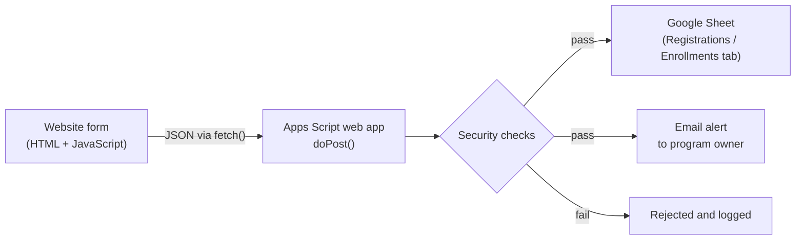

# Web Form to Google Sheets

A secure backend for website sign-up forms, built with Google Apps Script. I built it for a freelance client's youth sports program: parents fill out a registration or enrollment form on the client's website, and each submission is checked for spam, validated, saved to the right tab of a Google Sheet, and emailed to the program owner.

No paid form service is needed. The whole backend runs free on Google's infrastructure.

## How it works

1. **Frontend:** JavaScript on the website collects the form fields, packages them as JSON, and sends them to the web app with `fetch()`.
2. **Security checks:** the script runs every submission through the checks below. Anything that fails is rejected and logged.
3. **Storage:** valid submissions are appended to the correct tab, with columns matched to the existing headers.
4. **Notification:** the program owner gets an email with the submission details.

## Security features

| Feature | What it stops | How it works |
|---|---|---|
| **Honeypot field** | Simple spam bots | A hidden field real visitors never see. If it's filled in, the script quietly reports success but saves nothing, so the bot gets no signal it was caught. |
| **reCAPTCHA v3** | Automated submissions | Verifies Google's invisible bot score (must be 0.5 or higher) and checks that the action matches the form. |
| **Required-field and email validation** | Incomplete or junk data | Each tab has its own list of required fields. Emails are checked against a pattern. |
| **Rate limiting** | Flooding the sheet | Allows at most 5 submissions per email address per hour, tracked with `CacheService`. |
| **Formula injection protection** | Malicious spreadsheet formulas | Any text starting with `=`, `+`, `-`, or `@` is escaped so Google Sheets stores it as plain text instead of running it. |
| **Script lock** | Two submissions overwriting each other | `LockService` makes simultaneous submissions write one at a time. |
| **Server-side timestamps** | Fake or wrong dates | The submission time comes from the server, not the visitor's device. |
| **No secrets in code** | Leaked credentials | The reCAPTCHA secret, spreadsheet ID, and notification email are stored in Script Properties, not in the source. |

## Other features

- **Multiple forms, one backend:** the `sheet` field in the request picks the tab (`Registrations` or `Enrollments`), each with its own required fields.
- **Stable column layout:** fixed header order for known tabs, and new fields are added as new columns instead of breaking the sheet.
- **Debug log:** each step is written to a `Debug` tab, so problems can be diagnosed without digging through Apps Script logs.
- **Works inside website builders:** handles a known reCAPTCHA quirk when the form runs inside a cross-origin iframe, as Wix embeds do.

## Files

| File | What it is |
|---|---|
| `Code.gs` | The Google Apps Script backend |
| `frontend/index.html` | Main registration page: program info, bilingual (English/Spanish) content, and the registration form |
| `frontend/enroll.html` | Enrollment page: package and uniform selection, live price totals, and links to the payment provider |

Both pages are self-contained (styles, markup, and script in one file) so they can be pasted into a website builder's HTML component. All styles are scoped under one container ID so they can't affect the rest of the host site.

## Frontend security

| Feature | What it does |
|---|---|
| **Content Security Policy** (registration page) | Limits which sites the page may load scripts, fonts, and frames from, and where it may send data |
| **Origin allowlist for embedding** | When a page runs inside an iframe, it only talks to (`postMessage`) the client's own domains |
| **Payment link allowlist** (enrollment page) | Payment buttons only open links on the approved payment provider's domain |
| **Input limits and validation** | Fields have maximum lengths and are checked before the form submits |
| **Honeypot and reCAPTCHA token** | A hidden spam-trap field (registration page) and a reCAPTCHA token are sent with each submission for the backend to verify |

> All client details (business name, address, email, domains, payment links, and the live endpoint) have been replaced with placeholders such as `YOUR_WEB_APP_URL` and `example.com`.

## Setup

1. Create a Google Sheet and copy its ID from the URL: `https://docs.google.com/spreadsheets/d/<SPREADSHEET_ID>/edit`
2. Go to [script.google.com](https://script.google.com), create a new project, and paste in `Code.gs`.
3. In **Project Settings → Script Properties**, add:

   | Property | Value |
   |---|---|
   | `SPREADSHEET_ID` | Your sheet's ID |
   | `NOTIFY_EMAIL` | Where submission alerts should go (optional) |
   | `RECAPTCHA_SECRET` | Your reCAPTCHA v3 secret key (optional) |

4. **Deploy → New deployment → Web app.** Set "Execute as" to **Me** and "Who has access" to **Anyone**.
5. In both `frontend/index.html` and `frontend/enroll.html`, replace `YOUR_WEB_APP_URL` with the web app URL and `YOUR_RECAPTCHA_SITE_KEY` with your reCAPTCHA v3 site key. In `enroll.html`, also replace the `YOUR_PAYMENT_LINK_ID` links and the `example.com` domains with your own.
6. Submit a test entry and confirm a new row appears and the alert email arrives.

## Tech used

Google Apps Script (JavaScript) · Google Sheets · REST/JSON · reCAPTCHA v3 · `LockService` · `CacheService` · `PropertiesService` · `MailApp`

## What I learned

- Building an API endpoint that accepts and validates JSON
- Layering several spam and abuse protections instead of relying on just one
- Why user input should never be trusted, including in a spreadsheet (formula injection)
- Keeping secrets out of source code
- Handling concurrent requests safely with locks
